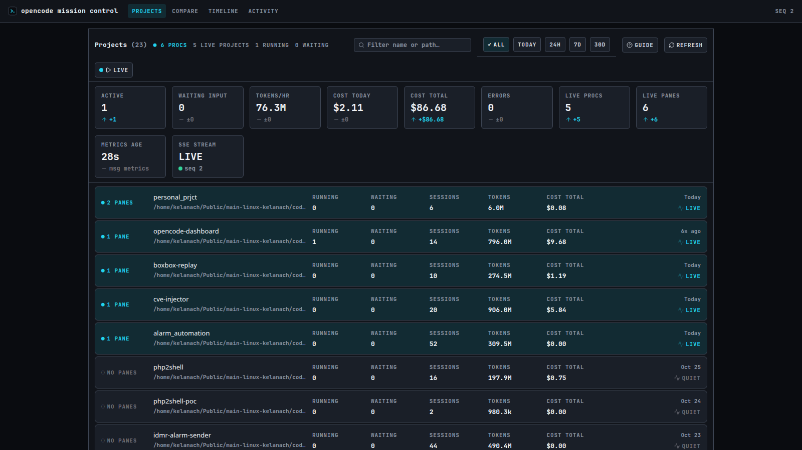
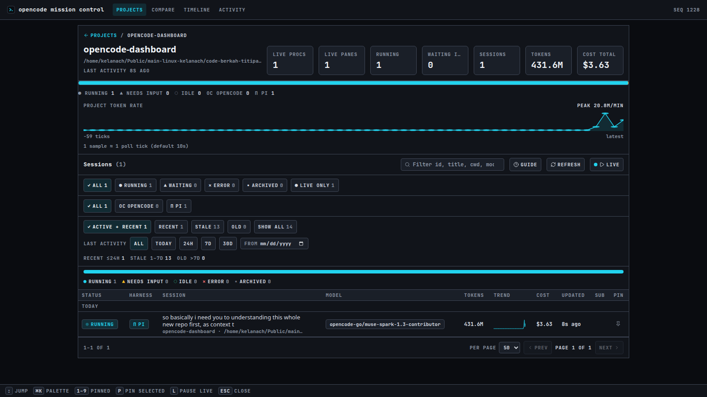
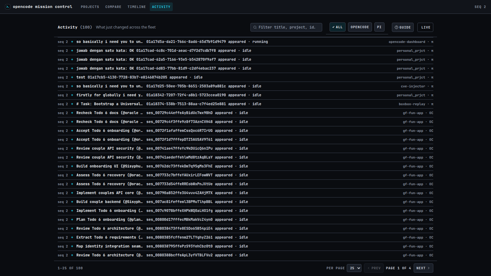
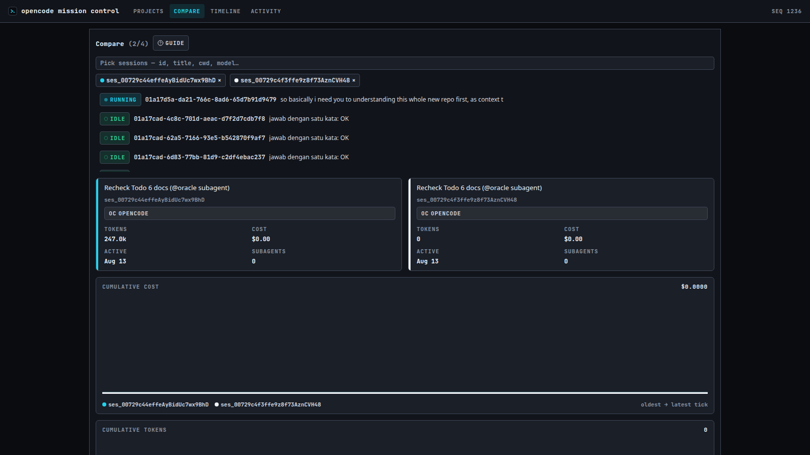
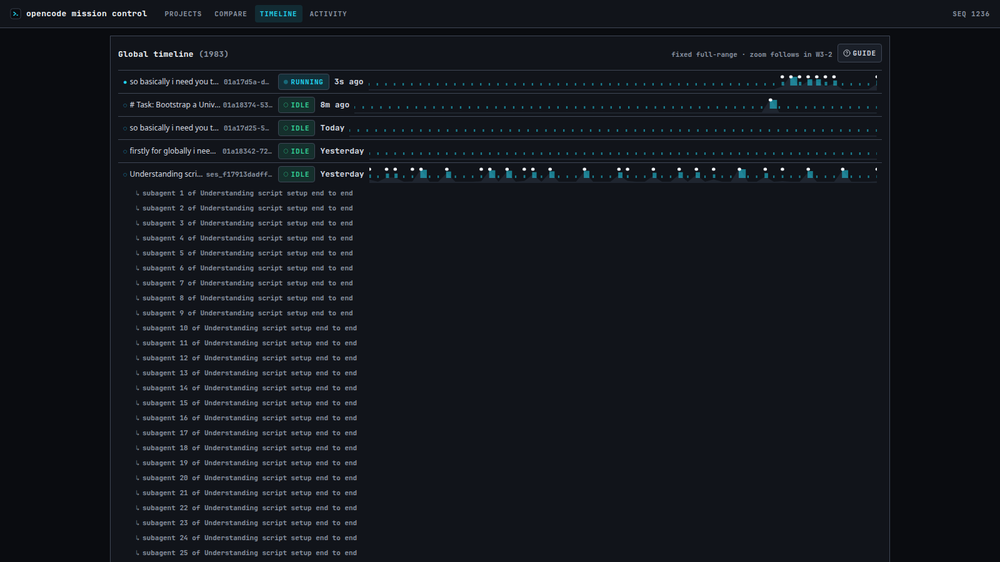
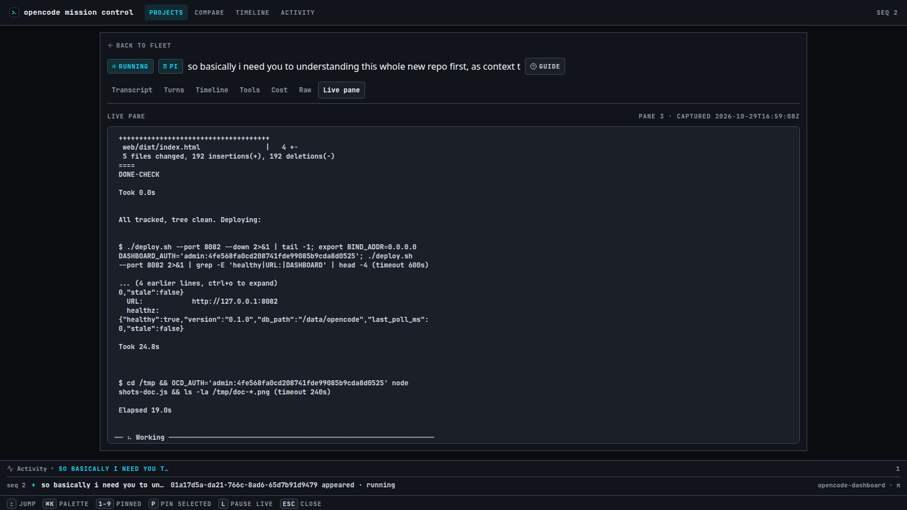

# opencode mission control

A single-container, read-only **mission-control dashboard for AI coding-agent sessions** running on one machine. It watches [opencode](https://opencode.ai) sessions (SQLite WAL store) **and** [pi](https://pi.dev) sessions (JSONL session store) side by side — every session's status, tokens, and cost, per-directory projects, live terminal panes, and a fleet-wide event log — with zero ability to leak credentials and zero public exposure.



## What it does

You run coding agents in terminal panes and lose track: which one is burning tokens, which is stuck waiting on you, what did that overnight run actually cost? Open one URL and see everything in <2s — status chips, token/cost KPIs, per-project drill-down, live pane text — for **both harnesses at once**, each row badged with its owner (OC / π).



## Features

- **Projects landing (default):** one card per working directory, ranked by live
  agent presence and recent activity, with session/running/waiting/tokens/cost
  totals, activity-date presets, text search, and pagination.
- **Fleet table (per project):** status chips (running / waiting-input / idle /
  error / archived), harness chips (OC opencode / π pi), Live-only toggle,
  search, pins, subagent expansion, per-row tokens/sparkline/cost/relative
  time, 5–50 rows/page, and URL-serialized state (filters + page survive
  reload and share links).
- **Multi-harness:** opencode rows (SQLite WAL) and pi rows (JSONL session
  files) merge into one fleet. Pi rows deep-link to the Live pane tab
  (pi transcript drill-down is the tracked P6 follow-up).
- **Session view:** Transcript / Turns / Timeline / Tools / Cost / Raw tabs
  plus a Subagents panel (live export data), and a **Live pane** tab showing
  the session's real terminal text on demand.
- **Status honesty:** recency-gated lifecycle (`ACTIVE_WINDOW`, default 2m) —
  only recently-active sessions may show running/waiting-input/error; older
  rows derive `idle`. `waiting-input` is a documented heuristic (no
  pending/permission table exists in either harness).
- **Project insight:** status distribution, harness split, and an aggregate
  token-rate area chart with per-sample tooltips — all derived from live rows.
- **Fleet-wide analysis:** Compare 2–4 sessions, a Global timeline of all
  sessions, and an **Activity log** (`#/activity`) — the full event feed with
  search, harness slice, and paging. The activity ring still accumulates in
  the App shell to feed this view; event rows deep-link to their sessions.
- **KPI strip:** Active / Waiting / Errors follow the date/bucket/harness/
  search filters; throughput, costs, and live presence stay global
  measurements. Cost cards switch windows with the date filter
  (total → today → 24h → 7d → 30d, message-level, both harnesses).
- **Guides everywhere:** a (?) DataGuide on every view explains statuses,
  harnesses, KPIs, recency, charts, and Live-pane states for new operators.
- **Read-only by construction:** no prompt, abort, resurrect, or shell route.







## 60-second quickstart

Prerequisites: Docker Engine 20.10+ with the Compose plugin, `curl`,
`ss`/`iproute2`, a host `zellij` (major must match the baked CLI, see below),
and `XDG_RUNTIME_DIR` set.

```bash
./deploy.sh                 # prereqs → build → up → verified banner
./deploy.sh --port 18082    # pin the listen port (auto-bumps when squatted)
./deploy.sh --down          # tear down and verify nothing runs/listens
```

Open the printed URL (`http://127.0.0.1:8080` by default). Click a project to
drill into its sessions, then a row for the session view. Empty lists are
fine on a host with nothing running.

To expose it on your tailnet afterwards: `tailscale serve --bg --https=443
http://127.0.0.1:$PORT` (serve, **never funnel** — see Security).

## Configuration

| Var | Source | Default | Effect |
|---|---|---|---|
| `PORT` | host env / `--port N` | `8080` | THE listen port (host mode: binary binds host `127.0.0.1:$PORT` directly, no mapping). Occupied → script auto-bumps and says so |
| `BIND_ADDR` | host env → compose | `127.0.0.1` | Listen address. Any non-loopback value is an explicit opt-in and the binary **refuses to start unless `DASHBOARD_AUTH` is valid**. Prefer `tailscale serve`; never expose non-loopback on a public host |
| `POLL_INTERVAL` | host env → compose | `10s` | Collector tick (DB + pi + zellij/proc join → snapshot). First tick may report `stale:true` — normal warm-up |
| `DB_TIMEOUT` | host env → compose | `10s` | Per-source bound for `PollState`/`Sessions` each tick. Malformed/non-positive falls back to default. A tick slower than 2× the poll interval is published as `stale`, never blanked |
| `ACTIVE_WINDOW` | host env → compose | `2m` | Status recency gate: only sessions whose activity is inside this window may show running/waiting-input/error; older rows derive `idle` (archived wins). Malformed/non-positive falls back to default |
| `DATA_DIR` | compose `environment` | `/data/opencode` | Read-only opencode data root in-container (parent dir mount keeps `-wal`/`-shm` sidecars visible) |
| `PI_DATA_DIR` | compose `environment` | `/data/pi-sessions` | Read-only pi session-store root in-container (`sessions/` subdir only — credential files never mounted). Default `$HOME/.pi/agent/sessions` locally. Missing/unreadable store = pi merge degrades warn-once, opencode fleet unaffected |
| `DASHBOARD_AUTH` | host env | unset (= open tailnet-trust mode) | `user:pass` (split on first colon) enables the Basic gate; malformed (no colon/empty part) = fail-closed refuse-to-serve. Successful Basic also mints the `ocd_session` cookie used by SSE. Value never logged |
| `TZ` | host env (`deploy.sh` detects) | host zone | Local-time attribution for `cost_today` (message spend since **local midnight**) and log stamps. Compose also mounts `/etc/localtime:ro`, so Go resolves the host zone even when `TZ` is empty |
| `UID` / `GID` | host (`export UID`; `GID=$(id -g)`) | `1000:1000` | Container user — MUST equal host user (zellij sockets are 0700, same-user effectively mandatory) |
| `XDG_RUNTIME_DIR` | host env | `/run/user/<uid>` | Must equal host value — the zellij CLI resolves sockets from it; mismatch = blind dashboard |
| `HOME` | host env | — | Only used to expand the `:ro` volume sources to your home (home itself is never mounted) |

Pinned at build: Go `1.27.3`, zellij `0.44.3` (major must match host), `gcr.io/distroless/static-debian12:nonroot`, image `opencode-dashboard:1.0.0`.

## Architecture

```
┌─ Host (netns shared: pid:host + network_mode:host) ──┐
│ zellij server → pane shells → opencode / pi procs     │
│ ~/.local/share/opencode/ (db + wal/shm + storage) :ro  │
│ ~/.pi/agent/sessions/ (JSONL session files) :ro       │
│ ~/.cache/zellij/ (EXITED metadata) :ro                │
│ $XDG_RUNTIME_DIR/zellij/ sockets (0700) :rw (CLI mints a client socket per call) │
│ /proc (pid:host liveness)                             │
└──────────────┬────────────────────────────────────────┘
               │ pid:host + net:host + :ro mounts (:rw socket dir only — no NAT)
┌─ Container ──▼──────────────────────────────────────────┐
│ Go single binary (distroless, no Node at runtime):     │
│  binds HOST 127.0.0.1:$PORT directly (asserted in-code)│
│  collector (poll 10s): DB reader + pi reader +         │
│    zellij/proc join → Snapshot{seq}                    │
│  SSE hub (/api/events) + REST (/api/fleet, …)          │
│  embedded SPA (web/dist served from the binary)        │
└──────────────┬──────────────────────────────────────────┘
               │ host loopback only — nothing on non-loopback
  tailscale serve (NOT funnel) → tailnet browsers
```

**Backend (`internal/`, Go 1.27, zero CGO).** Frozen seams in `internal/ports`
(`DBReader` / `PiReader` / `RuntimeSource` / `SnapshotSink` / `Config`):
`internal/db` reads the opencode WAL read-only through an indexed query
allowlist (full `part.data LIKE` scans are banned — the live DB is ~8 GB);
`internal/pi` parses JSONL session files with an mtime cache; `internal/runtime`
joins zellij (`list-sessions`, `list-panes -j`, on-demand `dump-screen`) with
`/proc` (CMD matching, CWD attribution, zombie-`Z`=dead, orphans); `internal/
collector` ticks every `POLL_INTERVAL` (watermark skip, stale-frame
degradation, per-source timeouts, off-tick message-level metrics refresher);
`internal/hub` fans out SSE (resume + re-sync) and serves REST + the embedded
SPA; `internal/auth` enforces the optional Basic gate with a bounded HttpOnly
session cookie for `EventSource`.

**Frontend (`web/`, React 19 + Vite 6 + TypeScript, no router library, no chart
library — hand-rolled SVG).** Hash routing (`#/` projects, `#/projects/:dir`
fleet, `#/sessions/:id/:tab`, `#/compare`, `#/timeline`, `#/activity`) with
filter/page state serialized in the URL. TS mirrors of the Go wire shapes
(`MIRROR` markers), design tokens in `web/DESIGN.md` with exactly one
hex-bearing file (`web/src/tokens.css`), status never conveyed by color
alone (always glyph + label).



## API

Same-origin SPA + JSON; no CORS headers by design.

| Route | Shape / semantics |
|---|---|
| `GET /api/healthz` | `{healthy, version, db_path, last_poll_ms, stale}` — `db_path` is the configured `DATA_DIR`. `stale:true` during warm-up (or when a tick exceeds 2× `POLL_INTERVAL` / a source fails) is a diagnostic, not necessarily an outage |
| `GET /api/fleet` | `{seq, sessions, projects, kpis, session_windows?}` — `seq` rises per published tick; empty `sessions` is fine with nothing running. `projects[]` groups by cleaned `session.directory` (live_procs desc → live_panes desc → running desc → last_activity asc → directory). `session_windows` is the sparse per-session trailing-window map backing project drill-in under date filters |
| `GET /api/sessions/:id` | Full detail: `{session, messages, todos, children}` from the live read-only DB. `404` unknown id, `503` backend unwired |
| `GET /api/sessions/:id/tools` | `{session_id, tools:[{name,status,duration_ms,tokens}]}`. `404` / `503` as above |
| `GET /api/sessions/:id/export` | Real session plus children, export-shaped (opencode harness; pi ids `404` until the transcript drill-down lands) |
| `GET /api/sessions/:id/screen` | Live pane text (`text/plain`, `X-Pane-Id` / `X-Captured-At` headers, `?full=0` = viewport-only; full scrollback is the default). `200` only for the session holding the pane claim; `409` + `{error, db_only:true, hint}` otherwise (no pane, or the pane belongs to the named session — transcript/DB still available); `404` unknown; `503` backend unwired / no snapshot yet; `504` dump timed out (10s) |
| `GET /api/events` (SSE) | `text/event-stream`: snapshot ticks emitted at a 500ms fan-out cadence + 20s keepalive; resume via `Last-Event-ID` / `?lastEventId=` with full-snapshot re-sync on reconnect; `503` hub closed. Under `DASHBOARD_AUTH`, authenticate with Basic once — the `ocd_session` cookie then authorizes `EventSource` (which cannot send an `Authorization` header) |
| `GET /api/debug/hub` | Drop counters + cadence (diagnostic only, not part of the frozen contract) |
| `GET /` | Embedded SPA (API routes take precedence) |

### Status derivation

`model.DeriveStatus` is pure (unit-tested): **archived → recency gate →
running > error → waiting-input (heuristic) → idle.** Only sessions active
inside `ACTIVE_WINDOW` may show running/waiting-input/error; error comes
only from the newest assistant turn (older errors don't stick); running
outranks error. opencode signals come from message/part/event slices;
pi signals map assistant `stopReason` onto the same five states
(`toolUse`/streaming → running, `stop`/`length` → waiting-input only when the
newest message is user-role, `error`/`aborted` → error).

### KPI semantics

| Field | Meaning |
|---|---|
| `active` / `waiting_input` / `errors` | Session counts by derived status **within the current date/bucket/harness/search scope** (not the status chips — those slice further) |
| `tokens_per_hour` | Message tokens created in the trailing 60s × 60, both harnesses. Measured from message/usage rows (not rolled-up session totals); a background refresher runs every 60s and the value decays to 0 when idle |
| `metrics_age_ms` | Live age = sample age + time since the frame arrived (ticks every second). `-1` = no successful refresh yet (unknown, not zero) |
| `cost_today` | Message-level USD spend since **local midnight** (`TZ` or `/etc/localtime`; without a zone the container is UTC and “today” starts early) |
| `cost_24h` / `cost_7d` / `cost_30d` | Message-level USD spend in the trailing windows, both harnesses (off-tick conditional-sum scan + in-memory pi events). The Cost card follows the date filter (today → `Cost today`, 24h/7d/30d → windowed, custom `from` → lifetime total) |
| `cost_total` | Lifetime USD spend, summing each session's own pre-roll-up cost (subagent children are not double-counted) |
| `live_processes` | Exact count of alive agent processes (opencode + pi) observed via `/proc` |
| `live_panes` | Live non-exited zellij panes **running an agent** (plain shells excluded, so the KPI reconciles with the per-project columns). Compare with `active`: far more running rows than panes means stale status, not hidden work |
| `session_windows` | Sparse per-session `{tokens/cost}_{24h,7d,30d}` — powers project drill-in attribution under date filters |
| `sse_connected` | Hub event-stream health |

`ProjectSummary` carries `{directory, name, sessions, running, waiting_input,
idle, tokens_total, cost_total, live_procs, live_panes, last_activity_ms}`.
`live_procs` is `/proc/<pid>/cwd`-derived on the host; in a container where
that readlink is denied, it falls back to agent panes (presence, not an exact
count); a just-exited pane can linger for one listing. `live_panes` counts
non-exited zellij panes running an agent per directory (same presence
semantics). Project tokens/cost are lifetime sums unless a 24h/7d/30d filter
is active (then windowed, with windowed labels).

## UI tour

| View (hash) | Purpose — what to read here |
|---|---|
| `#/` Projects | Ranked folders by live presence + recent activity. Filter by name, active-since presets, page through cards. Header totals and KPIs follow the filters. Start here. |
| `#/projects/:dir` Fleet | That directory's sessions: status/harness chips, search, pins, 5–50 rows/page, recency buckets + date presets. Header KPIs + insight chart describe the directory's time window. |
| `#/sessions/:id[/:tab]` | One session: Transcript / Turns / Timeline / Tools / Cost / Raw tabs (live export data) plus the Subagents panel, or the Live pane tab (opencode detail + live pane; pi rows deep-link to Live pane until transcript drill-down lands). |
| `#/compare?ids=a,b` | 2–4 sessions side by side: KPI cards + overlaid cost/token lines. Pick sessions to spot which run burns faster. |
| `#/timeline` | All sessions as swimlanes on one time axis: tool-call bars, completions, token-rate area, subagent nesting. Click a lane to drill in. |
| `#/activity` | The full event log: newest first, capped at the last 100 transitions, with search, harness slice, and paging. Movers collapse per session; status history accumulates. Every row deep-links to its session. |

Every view carries a (?) **DataGuide**: the Projects landing and fleet table
get the shared fleet glossary (statuses, harnesses, KPIs, recency,
sparks/rate, Live pane), while Compare, Timeline, Activity, and session
detail each get a tailored guide explaining exactly what that screen shows. Filter/page state lives in the
hash, so links survive reload and share. A collapsible **Refresh** button
re-pulls the snapshot on demand (works paused).

## Development

```bash
go build ./...             # backend must compile
go vet ./...               # static checks
go test -count=1 ./...    # full backend suite (9 packages, all green)
```

```bash
npm run lint --prefix web  # tsc --noEmit (type gate)
npm test --prefix web -- --run   # vitest (261 tests / 33 files)
npm run build --prefix web       # tsc + vite build → web/dist (committed fallback)
grep -rE '#[0-9a-fA-F]{6}' web/src  # must hit only src/tokens.css
```

`deploy.sh` rebuilds `web/dist` automatically when `web/src/**` is newer than
`web/dist/index.html` (and fails loud with install instructions if `npm` is
missing); otherwise the committed `dist` is reused so no-Node hosts still work.

Quality gates (run before claiming done): tests + lint + type checks +
Security Gate (`docs/SECURITY.md` §5, runnable verbatim). No weakening
controls to make things pass. See `CONTRIBUTING.md`.

## Project structure

| Path | One line |
|---|---|
| `deploy.sh` | One-click deploy: prereqs → dist → `up --build` → health wait → curl proofs → banner / `--down` teardown |
| `docker-compose.yml` | Plug-n-play spec: `pid:host` + `network_mode:host`, UID parity, `:ro` allowlist (`:rw` socket dir only), no `ports:` stanza, exec healthcheck |
| `Dockerfile` | 3-stage build: pinned zellij CLI → Go static binary (embeds SPA) → distroless runtime |
| `cmd/dashboard/` | Entrypoint: loopback assert, loud self-checks, seam wiring, API+SPA on one listener, `-healthcheck` probe |
| `internal/ports/` | Frozen seams: `DBReader` / `PiReader` / `RuntimeSource` / `SnapshotSink` / env `Config` (+ `WindowMetrics`, `PiDataDir`) |
| `internal/db/` | Read-only WAL reader: indexed per-session slices only (full `part.data LIKE` scans banned) + message-level metrics + trailing-window sums |
| `internal/pi/` | Read-only JSONL reader: per-file parses with mtime cache, shared status gate, usage events, windowed metrics |
| `internal/runtime/` | zellij CLI + `/proc` join: (directory,harness) pane claims, liveness #1, orphans, zombie-`Z`=dead, harness-scoped `dump-screen` |
| `internal/collector/` | Poll loop → `Snapshot{seq}`; pi merge; pi-aware watermark; stale-frame self-heal; combined metrics refresher; never per-tick screen |
| `internal/hub/` | SSE fan-out (resume + re-sync) + REST handlers (claimant-only screen with owner-naming 409s) + frozen response shapes |
| `internal/model/` | `SessionRow` (+`Harness`), `Snapshot` (+`SessionWindows`), `WindowSums`, status derivation |
| `internal/auth/` | `DASHBOARD_AUTH` gate: Basic-or-cookie-or-open, fail-closed, zero logging (test-pinned) |
| `web/src/views/` | `Projects`, `Fleet`, `SessionDetail` (+ screen tab), `Compare`, `GlobalTimeline`, `Activity` |
| `web/src/components/` | KpiStrip, ActivityRow, CmdBar, StatusBadge, HarnessBadge, DataGuide, RateChart, ProjectInsight, RefreshButton, Sparkline, filters, Pagination, SubagentPanel |
| `web/src/lib/` | `sse.ts` transport, `activity.ts` ring (collapse + scoping), sorting/filtering, rate sums, projects, pins, routing, formatting |
| `web/src/testutils/` | Snapshot + `sessionDetail.fixture.ts` (test-only `SessionDataProvider`) |
| `web/dist/` | Committed SPA build (fallback so containers build without Node) |
| `web/DESIGN.md` | Design tokens + anti-slop rules (authoritative for color) |
| `docs/` | `screenshots/` · `DOCKER_VERIFY.md` (rerun playbook) · `VM_DEPLOY.md` (VM runbook + F2 truth matrix) · `SECURITY.md` (threat model + gate checklist) · `ACTIONS_DEFERRED.md` (why v1 is read-only) |
| `.omo/` | Work plan + research notepads (decisions, issues, runtime-observability findings) |

## Security (summary)

Read-only by construction: no prompt injection path, no shell exec from the UI.
Mount allowlist: opencode parent dir (DB + `-wal`/`-shm` + storage), pi
`sessions/` subdir only, zellij cache, and `/etc/localtime` are `:ro`; only
the zellij socket dir is `:rw` because the CLI mints a per-call client socket.
`auth.json` files and credential/account stores are never mounted and no query
touches those tables (the pi reader opens `*.jsonl` only — pinned by test).
Loopback-only by default (Go bind assert on the configured address; compose
carries no `ports:` stanza; `tailscale serve` fronting) — **funnel is
banned**: Basic auth is base64 (reversible, not encryption) and must never
face the public internet. A non-loopback `BIND_ADDR` is allowed only with
valid auth. When `DASHBOARD_AUTH` is set, Basic gates the API + SPA and a
successful check mints an HttpOnly `ocd_session` cookie (12h, bounded 32-token
store, `SameSite=Lax`, `Secure` over TLS) so SSE can authenticate. No secrets
in image/API/logs. Full model: `docs/SECURITY.md` (§5 checklist runnable
verbatim).

## Runbooks

- **VM deploy + F2 truth matrix:** `docs/VM_DEPLOY.md` (§0 prereqs, §1 deploy, §3 live-pane/orphan/EXITED/zombie checks).
- **Deferred actions (abort/resurrect):** `docs/ACTIONS_DEFERRED.md` — design sketch only, no code.
- **Docker rerun playbook:** `docs/DOCKER_VERIFY.md`.

## Troubleshooting

| Symptom | Cause → fix |
|---|---|
| Blind dashboard (fleet empty, zero panes, looks healthy) | UID/XDG/major skew: `id -u` vs `docker exec <ctr> id -u`; `echo $XDG_RUNTIME_DIR` vs container value; host `zellij --version` major vs baked `0.44.3`; `ls $XDG_RUNTIME_DIR/zellij/contract_version_1/` must list live sessions → `docker compose down`, fix env, `up -d --build` (details: `docs/VM_DEPLOY.md` §4) |
| Stale fleet (`stale:true` persists) | WAL sidecars hidden (mount must be the parent `opencode/` dir, never the bare `.db` file) or DB budget pressure (`DB_TIMEOUT` exceeded; first 2–3 polls normal — wait, don't redeploy): `docker inspect <ctr> --format '{{json .Mounts}}'` must equal the allowlist (`:ro` everywhere except the socket dir, which is `:rw` so the CLI can mint its client socket). Check the collector log for `context deadline exceeded`; raise `DB_TIMEOUT` or lower `POLL_INTERVAL` pressure rather than widening mounts |
| `cost_today` looks wrong (too high early in the day) | Container has no zone: `cost_today` uses local midnight, so a UTC container starts “today” hours early on e.g. a WIB host. `deploy.sh` forwards `TZ` from the host and compose mounts `/etc/localtime:ro`; verify `docker exec <ctr> date` and `printenv TZ` match the host |
| Project `live_procs`/`live_panes` disagree or look stale | Per-directory presence is a signal, not a process census. On the host `live_procs` is `/proc/<pid>/cwd`-derived; in-container that readlink is denied, so it falls back to agent panes and may briefly include a just-exited pane. `live_processes` remains the exact `/proc` count. `live_panes` counts agent panes only (shells excluded) so the KPI reconciles with the cards |
| KPI card won't change under a date filter | By design, only Active/Waiting/Errors (and the Cost card window) follow the date filter; throughput, live presence, and lifetime totals are global measurements. Custom `from` falls back to lifetime totals |
| Port taken (`address already in use`) | Squatted host port (8080 was squatted on the dev host): `./deploy.sh` auto-bumps and says so — or pin one: `./deploy.sh --port 18082` (host mode: `$PORT` IS the listen port, no container/host split) |
| `0.0.0.0` confusion (bound/published openly) | Default posture forbids it: the binary binds `127.0.0.1` unless `BIND_ADDR` is explicitly set, and a non-loopback value refuses to start without valid `DASHBOARD_AUTH`. Compose has NO `ports:` stanza (host mode — nothing to misconfigure); `ss -tlnp \| grep $PORT` must show the dashboard binary directly (no `docker-proxy` line) |
| zellij major skew, no loud FATAL | Socket contract dir (`contract_version_1`) is version-sensitive; skew has no dedicated FATAL — it surfaces as blindness (boot log line `zellij detected` shows baked version). Majors differ → rebuild image with matching `ZELLIJ_VERSION`, do not proceed |

## Known limitations

- **Read-only v1.** No abort, resurrect, prompt, message, or shell endpoint. Design
  sketch + open questions: `docs/ACTIONS_DEFERRED.md`.
- **Single host.** The collector joins one host's zellij + `/proc`; there is no `host_id`
  plumbing or multi-host fan-in yet.
- **Pi transcript drill-down is pending.** Pi rows deep-link to the Live pane tab;
  Transcript/Turns/Timeline/Tools/Cost/Raw tabs show the honest empty state until
  the export-shaped pi route lands (tracked follow-up).
- **`waiting-input` is a heuristic.** Neither harness has a pending/permission table;
  the state means “user spoke last, nothing in flight, recent” (plus compacting).
- **Recency window can read idle during a long silent tool call.** `ACTIVE_WINDOW` (2m)
  gates status on activity; a genuinely busy turn that produces no events for a
  full window will show idle.
- **Per-directory presence is pane-derived in-container.** `/proc/<pid>/cwd` is denied
  under ptrace/Yama, so `projects[].live_procs` falls back to agent panes;
  `live_processes` remains the exact `/proc` count.
- **Metrics can be up to ~60 s stale.** Throughput/cost/windows come from a
  background refresh; read `metrics_age_ms` (ticking live) before trusting them.
- **Windowed costs need fixed presets.** Custom `from` dates fall back to lifetime
  totals; per-day attribution beyond today/24h/7d/30d is not computed.
- **F2 VM truth matrix is outstanding.** The manual 3-pane / orphan / EXITED /
  zombie / CWD-mismatch matrix in `docs/VM_DEPLOY.md` §3 (human-run only).

## Roadmap

- Pi transcript drill-down (export-shaped pi route feeding all detail tabs).
- Deferred actions wave (abort/resurrect — blocked on design + threat-model reopen).
- Notifications + daily cost budget (browser Notification API on waiting-input flips, long turns, budget crossing; client-only, read-only posture unchanged).
- In-tab transcript search (client-side filter over the loaded export).
- Multi-host seam (`host_id` across collector/snapshot/UI).
- Narrow/phone layout; event-tail/dedupe stress tests; CI + automated scans.

## Contributing

Issues and PRs welcome. Ground rules (enforced by review):

- Small, focused commits; no unrelated changes; never commit secrets.
- Every feature has tests; every bug fix has a regression test; gates must pass:
  `go build ./...`, `go vet ./...`, `go test -count=1 ./...`,
  `npm run lint --prefix web`, `npm test --prefix web -- --run`,
  `npm run build --prefix web`, token gate
  (`grep -rE '#[0-9a-fA-F]{6}' web/src` → only `src/tokens.css`).
- Security Gate (`docs/SECURITY.md` §5) for every change touching
  mounts, network, auth, queries, or dependencies. Never weaken a control to
  make something pass; never work around a denied permission.
- UI changes follow `web/DESIGN.md` (tokens, glyph+label status language,
  no new hex, no gradients/glassmorphism).
- Update docs in the same change as code; wrap up state files when applicable.

## License

MIT — see [LICENSE](./LICENSE).

Bundled-dependency licenses live in their own packages (`go.mod` / `package-lock.json` record them; `web/dist/` is built output of already-listed deps).
